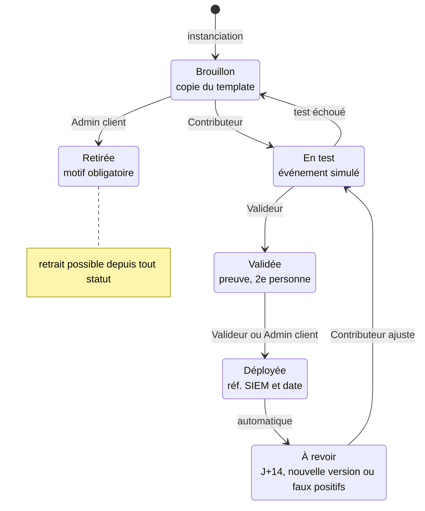
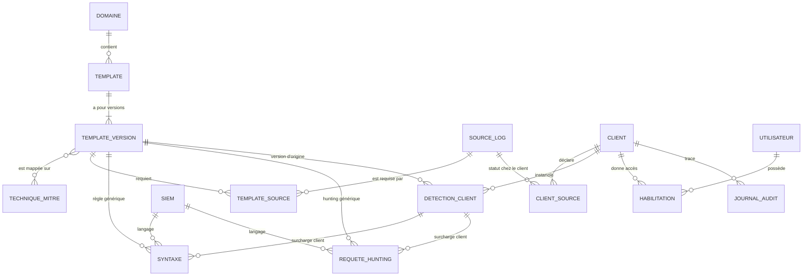
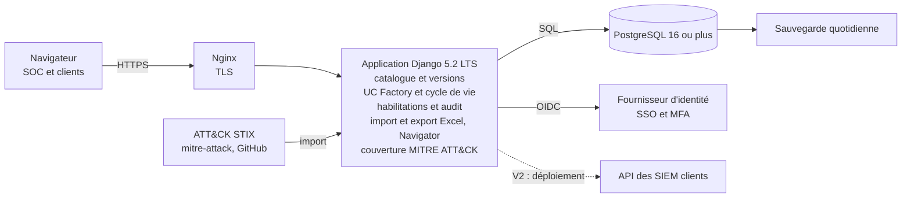

# UC Factory SOC – Plan de développement

19/10/2026 · jassem

L'UC Factory transforme le catalogue Excel v1.0 (82 détections, 11 domaines, 28 sources de logs) en application web : un référentiel de templates maintenu par le SOC, instancié pour chaque client avec ses droits d'accès, son mapping MITRE ATT&CK, ses règles par SIEM et ses requêtes de hunting. Stack recommandée : Django 5.2 LTS, PostgreSQL et HTMX ; livraison en 5 lots sur environ 12 semaines (estimation).

## Sommaire

1. [Objectifs et périmètre](#objectifs-et-périmètre)
2. [Rôles et droits par client](#rôles-et-droits-par-client)
3. [Parcours : créer l'UC Factory d'un client](#parcours--créer-luc-factory-dun-client)
4. [Cycle de vie d'une détection client](#cycle-de-vie-dune-détection-client)
5. [Modules fonctionnels](#modules-fonctionnels)
6. [Modèle de données](#modèle-de-données)
7. [Syntaxe par SIEM et requêtes de hunting](#syntaxe-par-siem-et-requêtes-de-hunting)
8. [Mapping MITRE ATT&CK](#mapping-mitre-attck)
9. [Import du catalogue Excel v1.0](#import-du-catalogue-excel-v10)
10. [Architecture et choix techno](#architecture-et-choix-techno)
11. [Plan de livraison](#plan-de-livraison)
12. [Critères d'acceptation](#critères-dacceptation)
13. [Questions ouvertes](#questions-ouvertes)

## Objectifs et périmètre

La V1 remplace le fichier Excel par une application partagée : le catalogue devient un ensemble de templates versionnés, et chaque client reçoit sa propre UC Factory instanciée à partir de ces templates.

**Objectifs de la V1**

- Importer le catalogue v1.0 (feuilles Detections, Sources_logs et Lisez-moi) sans ressaisie.
- Gérer les templates : créer, modifier, versionner et retirer une détection.
- Créer l'UC Factory d'un client : choisir ses domaines, ses sources de logs collectées et son ou ses SIEM, puis instancier les détections applicables.
- Stocker pour chaque détection la règle propre à chaque SIEM et ses requêtes de hunting : Wazuh, Splunk, Sentinel / Defender XDR (KQL), Elastic, et QRadar (ajout proposé, absent du fichier).
- Afficher la couverture MITRE ATT&CK du catalogue et de chaque client.
- Contrôler les droits par client : lecture, écriture, validation et administration.
- Exporter l'UC Factory d'un client en Excel et en layer ATT&CK Navigator.

**Hors V1 (proposé pour la V2)**

- Déploiement automatique des règles dans les SIEM des clients par leurs API.
- Génération automatique des syntaxes depuis un format pivot Sigma.
- Suivi des alertes et des incidents : il reste dans le SIEM et l'outil de ticketing.

**Ce qui ferait échouer le projet, même si l'application fonctionne**

- Un utilisateur voit les données d'un client sur lequel il n'a aucun droit.
- Une nouvelle version d'un template écrase sans prévenir les réglages d'un client (seuils, exclusions, syntaxe adaptée).

## Rôles et droits par client

Les droits se donnent client par client : une habilitation relie un utilisateur, un client et un rôle, et une même personne peut être Valideur chez un client et Lecteur chez un autre. Deux rôles sont globaux (Administrateur plateforme, Responsable catalogue), les quatre autres sont propres à un client.

| Permission | Admin plateforme | Responsable catalogue | Admin client | Valideur | Contributeur | Lecteur |
| --- | --- | --- | --- | --- | --- | --- |
| Voir le catalogue de templates | Oui | Oui | Oui | Oui | Oui | Oui |
| Créer, modifier, versionner un template | Oui | Oui | Non | Non | Non | Non |
| Créer un client et son UC Factory | Oui | Non | Non | Non | Non | Non |
| Voir l'UC Factory du client | Oui | Non | Oui | Oui | Oui | Oui |
| Modifier une détection client (seuils, exclusions, syntaxe, hunting) | Oui | Non | Oui | Oui | Oui | Non |
| Passer une détection à « Validée » ou « Déployée » | Oui | Non | Oui | Oui | Non | Non |
| Appliquer une nouvelle version de template au client | Oui | Non | Oui | Oui | Non | Non |
| Gérer les habilitations du client | Oui | Non | Oui | Non | Non | Non |
| Exporter (Excel, layer ATT&CK Navigator) | Oui | Non | Oui | Oui | Oui | Oui |
| Consulter le journal d'audit du client | Oui | Non | Oui | Oui | Non | Non |

**Règles à implémenter**

- Le contrôle se fait côté serveur à chaque requête : toute lecture de données client est filtrée par les habilitations de l'utilisateur, jamais par un simple identifiant dans l'URL.
- Un Responsable catalogue sans habilitation ne voit pas les données des clients, seulement le nombre de clients qui utilisent chaque template.
- Double validation (proposition) : l'auteur d'une modification ne peut pas valider sa propre modification.
- Chaque écriture est tracée dans le journal d'audit : qui, quand, quel objet, valeur avant et après.
- Authentification par SSO OpenID Connect (Entra ID ou autre IdP du SOC) avec MFA ; un compte local de secours seulement pour l'Admin plateforme.

## Parcours : créer l'UC Factory d'un client

Le parcours reprend les 5 étapes de la feuille Lisez-moi et les rend guidées : l'application filtre, signale les sources manquantes et garde la trace de chaque décision.

1. **Créer le client** : nom, secteur, SIEM utilisés (un ou plusieurs), Admin client désigné.
2. **Déclarer le périmètre technique** : cocher les domaines du client (Windows, Linux, web, cloud…) et, pour chacune des 28 sources de logs, son statut : Collectée, À activer ou Sans objet.
3. **Obtenir la proposition** : l'application liste les templates applicables, c'est-à-dire domaine retenu et sources requises collectées. Les autres s'affichent « bloqués » avec la source à activer et la consigne de la feuille Sources_logs.
    - Par défaut, une seule source collectée suffit. Le Responsable catalogue peut marquer une source « obligatoire » sur un template, par exemple pour une corrélation pare-feu + EDR.
4. **Prioriser et instancier** : tri par défaut Critique et Haute de type Simple d'abord. Chaque détection retenue copie la version courante du template et la syntaxe du SIEM du client, au statut Brouillon.
5. **Adapter au client** : seuils, fenêtres, exclusions, listes de référence (comptes admin, serveurs, IOC), règle et requêtes de hunting.
6. **Tester sans risque** : rejouer un événement simulé ou une ligne de log, jamais l'attaque réelle. La preuve est jointe : date, résultat, capture.
7. **Valider puis déployer** : un Valideur passe la détection à Validée, puis à Déployée avec la date et la référence de la règle dans le SIEM.
8. **Revoir après observation** : l'application rappelle au bout de 2 semaines d'ajuster les seuils, puis à chaque nouvelle version du template.

## Cycle de vie d'une détection client

Une détection client passe par 6 statuts, et le passage à Validée exige un Valideur ou un Admin distinct de l'auteur (double validation proposée).



Le retrait est possible depuis tout statut, avec un motif. Une détection À revoir repasse par En test avant d'être redéployée.

## Modules fonctionnels

L'application compte 13 modules, livrés en 4 lots de développement après un lot 0 de cadrage. Le journal d'audit enregistre dès le lot 1, son écran de consultation arrive au lot 4.

| Module | Fonctions | Lot |
| --- | --- | --- |
| Authentification et habilitations | SSO OIDC avec MFA, rôles globaux, habilitations par client, écran « qui a accès à quoi » | 1 |
| Référentiels | Domaines, sources de logs (consignes et pièges), SIEM et leurs langages, techniques MITRE ATT&CK | 1 |
| Import Excel | Import du catalogue v1.0, rapport d'anomalies, réimport sans doublon | 1 |
| Journal d'audit | Enregistrement de chaque écriture (lot 1), écran filtrable par client, utilisateur et objet (lot 4) | 1 et 4 |
| Catalogue de templates | Liste filtrable (domaine, type, gravité, technique, source), fiche détaillée, création, modification, retrait | 2 |
| Versionnage des templates | Version par template, historique, comparaison entre deux versions, note de changement | 2 |
| Syntaxes SIEM et hunting | Règle par SIEM, requêtes de hunting par SIEM, guide de traduction issu du Lisez-moi, coloration syntaxique | 2 |
| Clients et périmètre | Fiche client, SIEM utilisés, domaines retenus, statut des 28 sources de logs | 3 |
| UC Factory client | Proposition, instanciation, adaptation, cycle de vie, preuves de test | 3 |
| Mise à jour de version | Bandeau « nouvelle version disponible », comparaison, application sélective sans perte des réglages client | 3 |
| Couverture MITRE ATT&CK | Matrice du catalogue et de chaque client, filtre par statut, techniques non couvertes | 4 |
| Exports | Excel par client au format du catalogue, layer ATT&CK Navigator (JSON), CSV | 4 |
| Tableau de bord client | Détections par statut, sources à activer, revues en retard | 4 |

## Modèle de données

Le modèle sépare le générique (templates et leurs versions figées) du spécifique (détections client). Une détection client pointe toujours vers la version de template dont elle est issue, ce qui permet de comparer et d'appliquer une nouvelle version sans perdre les réglages du client.



Les « surcharges client » sont les Syntaxe et RequeteHunting rattachées à une DetectionClient plutôt qu'à une TemplateVersion. UTILISATEUR correspond au modèle utilisateur de Django.

| Entité | Rôle | Champs clés |
| --- | --- | --- |
| Domaine | Les 11 domaines du catalogue | nom, ordre d'affichage |
| SourceLog | Les 28 sources de la feuille Sources_logs | nom, à activer, événements clés, piège fréquent |
| Siem | SIEM ou XDR supporté | nom, langage de règle (XML Wazuh, SPL, KQL, EQL ou ES\|QL, AQL), langage de hunting |
| TechniqueMitre | Référentiel ATT&CK importé | identifiant (T1110.001), nom, tactiques, technique parente, version ATT&CK, obsolète |
| Template | La détection générique | code (DET-001), domaine, statut (actif, retiré), version publiée courante |
| TemplateVersion | Contenu figé d'une version publiée | numéro, cas d'usage, type, logs à collecter, logique, gravité, paramètres par défaut (seuil, fenêtre, clé de regroupement), note de changement, auteur, date |
| TemplateSource | Lien version ↔ source de logs | source, obligatoire (oui ou non) |
| Syntaxe | Règle de détection pour un SIEM | SIEM, contenu, champs requis, notes ; rattachée à une TemplateVersion ou à une DetectionClient |
| RequeteHunting | Recherche manuelle sur l'historique | SIEM, titre, objectif, requête, période conseillée ; même rattachement que Syntaxe |
| Client | Un client du SOC | nom, secteur, SIEM utilisés, domaines retenus, actif |
| ClientSource | Statut d'une source chez un client | source, statut (Collectée, À activer, Sans objet), commentaire |
| DetectionClient | Instance d'un template chez un client | template, version d'origine, statut, paramètres du client, exclusions, propriétaire, date de déploiement, prochaine revue, preuve de test |
| Habilitation | Droit d'un utilisateur sur un client | utilisateur, client, rôle |
| JournalAudit | Trace de chaque écriture | utilisateur, date, client, objet, action, valeur avant et après (JSON) |

Une TemplateVersion publiée n'est plus modifiable : toute correction crée une nouvelle version, d'abord en brouillon. Les liens vers TechniqueMitre se font au niveau de la version, car le mapping peut changer d'une version à l'autre.

## Syntaxe par SIEM et requêtes de hunting

Chaque template porte, pour chaque SIEM, une règle de détection (planifiée, avec seuil) et une ou plusieurs requêtes de hunting (recherche manuelle sur l'historique, sans seuil strict). La V1 stocke ces textes tels quels ; leur génération depuis Sigma est prévue en V2.

**Contenu d'une fiche Syntaxe**

- SIEM et langage, avec coloration syntaxique à l'écran.
- Texte de la règle, avec des paramètres nommés : `{{seuil}}`, `{{fenetre}}`, `{{liste_admins}}`. À l'export, ils sont remplacés par les valeurs du client.
- Champs requis (par exemple `win.eventdata.targetUserName`), pour vérifier la normalisation chez le client.
- Prérequis et notes de mise en œuvre.
- Le guide de traduction du Lisez-moi (Seuil, Corrélation, Valeurs distinctes, Liste de référence) s'affiche à côté de l'éditeur, pour le SIEM choisi.

**Exemple : DET-001, force brute suivie d'une connexion réussie**

Logique du catalogue : si 8 échecs ou plus sur un même compte en 10 min, puis 1 succès de ce compte. Les valeurs 8 et 10 min sont écrites en clair ci-dessous ; en base elles sont stockées en `{{seuil}}` et `{{fenetre}}`. Ces exemples sont à valider sur un environnement de test : les noms de champs et les identifiants de règles parentes dépendent de la version et de la normalisation de chaque SIEM.

Wazuh (règles locales, corrélation par règle fille) :

```xml
<group name="uc_factory,authentication,">
  <!-- DET-001 étape 1 : au moins 8 échecs du même compte en 10 min -->
  <rule id="100100" level="8" frequency="8" timeframe="600">
    <if_matched_sid>60122</if_matched_sid>
    <same_field>win.eventdata.targetUserName</same_field>
    <description>DET-001 : 8 échecs d'authentification pour $(win.eventdata.targetUserName) en 10 min</description>
    <mitre><id>T1110.001</id></mitre>
  </rule>
  <!-- DET-001 étape 2 : succès du même compte après l'étape 1 -->
  <rule id="100101" level="12" timeframe="600">
    <if_sid>60106</if_sid>
    <if_matched_sid>100100</if_matched_sid>
    <same_field>win.eventdata.targetUserName</same_field>
    <description>DET-001 : connexion réussie de $(win.eventdata.targetUserName) après une force brute</description>
    <mitre><id>T1110.001</id><id>T1078</id></mitre>
  </rule>
</group>
```

Splunk (recherche planifiée toutes les 10 min) :

```spl
index=wineventlog (EventCode=4625 OR EventCode=4624)
| bin _time span=10m
| stats count(eval(EventCode=4625)) AS echecs
        max(eval(if(EventCode=4625, _time, null()))) AS dernier_echec
        max(eval(if(EventCode=4624, _time, null()))) AS dernier_succes
        values(src_ip) AS ip_sources
        BY _time, user
| where echecs>=8 AND dernier_succes>dernier_echec
```

Microsoft Sentinel (règle analytique planifiée, KQL) :

```kql
let seuil = 8;
let fenetre = 10m;
let echecs = SecurityEvent
    | where TimeGenerated > ago(1h)
    | where EventID == 4625
    | summarize NbEchecs = count(), DernierEchec = max(TimeGenerated) by TargetAccount, bin(TimeGenerated, fenetre)
    | where NbEchecs >= seuil;
echecs
| join kind=inner (
    SecurityEvent
    | where TimeGenerated > ago(1h)
    | where EventID == 4624
    | project Succes = TimeGenerated, TargetAccount, IpAddress
  ) on TargetAccount
| where Succes between (DernierEchec .. (DernierEchec + fenetre))
| project TargetAccount, NbEchecs, DernierEchec, Succes, IpAddress
```

Elastic Security (règle EQL de type séquence) :

```eql
sequence by user.name with maxspan=10m
  [authentication where event.outcome == "failure"] with runs=8
  [authentication where event.outcome == "success"]
```

QRadar : la corrélation se construit dans l'assistant de règles (CRE). La requête AQL ci-dessous sert au contrôle et au hunting ; la propriété "EventID" dépend du DSM installé.

```sql
SELECT username, sourceip, COUNT(*) AS echecs, MAX(starttime) AS dernier_echec
FROM events
WHERE LOGSOURCETYPENAME(devicetype) = 'Microsoft Windows Security Event Log'
  AND "EventID" = '4625'
GROUP BY username, sourceip
HAVING echecs >= 8
LAST 10 MINUTES
```

**Requête de hunting associée (Sentinel, 7 jours)** : elle cherche sur l'historique les comptes ayant subi beaucoup d'échecs puis un succès, sans la contrainte des 10 min.

```kql
SecurityEvent
| where TimeGenerated > ago(7d)
| where EventID in (4624, 4625)
| summarize Echecs = countif(EventID == 4625),
            Succes = countif(EventID == 4624),
            PremierEchec = minif(TimeGenerated, EventID == 4625),
            DernierSucces = maxif(TimeGenerated, EventID == 4624),
            IpSources = make_set(IpAddress, 20)
    by TargetAccount
| where Echecs >= 20 and Succes > 0 and DernierSucces > PremierEchec
| order by Echecs desc
```

## Mapping MITRE ATT&CK

Le mapping est porté par chaque version de template ; la couverture d'un client se calcule à partir de ses détections, filtrée par statut (par défaut : Déployée seulement).

**Référentiel**

- Importer le bundle STIX officiel ATT&CK Enterprise (dépôt GitHub mitre-attack/attack-stix-data) dans la version citée par le catalogue, v19.2.
- Stocker pour chaque technique : identifiant, nom, tactiques, technique parente, statut révoqué ou obsolète.
- À l'import du catalogue, chaque identifiant doit exister dans la version chargée ; sinon il part dans le rapport d'anomalies. Les identifiants T1675, T1685, T1686 et T1690 du fichier sont à contrôler en priorité contre ce référentiel.
- Une détection peut n'avoir aucune technique (cas de DET-081, noté « — »).
- À chaque nouvelle version d'ATT&CK, l'application liste les techniques renommées, révoquées ou remplacées qui touchent des templates. Le Responsable catalogue les remappe dans une nouvelle version de template.

**Écrans**

- Matrice tactiques × techniques : couleur selon le nombre de détections (catalogue) ou le statut le plus avancé (client).
- Filtres : domaine, gravité, SIEM, statut client.
- Techniques non couvertes d'un client, avec les templates qui les couvriraient et la source de logs qui manque.

**Export ATT&CK Navigator**

- Un layer JSON par client : score = nombre de détections déployées par technique, commentaire = codes DET concernés.
- Le Navigator sert aux présentations client ; la matrice intégrée reste simple et ne cherche pas à le reproduire.

## Import du catalogue Excel v1.0

L'import crée les 82 templates en version 1.0 publiée, les 28 sources et les 11 domaines, après une simulation qui affiche ce qui sera créé, mis à jour ou rejeté. Un réimport d'une version ultérieure du fichier ne crée une nouvelle version que pour les lignes modifiées.

| Feuille et colonne | Donnée cible | Règle de transformation |
| --- | --- | --- |
| Detections A « ID » | Template.code | Clé unique (DET-001 à DET-082) ; un réimport met à jour, sans doublon |
| Detections B « Domaine » | Domaine | Doit figurer parmi les 11 domaines listés dans Lisez-moi |
| Detections C « Cas d'usage » | TemplateVersion, cas d'usage | Texte |
| Detections D « Type » | TemplateVersion, type | Simple, Seuil ou Corrélation |
| Detections E « Logs à collecter » | TemplateVersion, logs | Texte |
| Detections F « Source des logs » | TemplateSource | Une source par ligne de la cellule ; chaque nom doit exister dans Sources_logs |
| Detections G « Logique de la règle » | TemplateVersion, logique | Texte ; seuils et fenêtres repris en paramètres au lot 2 |
| Detections H « Gravité » | TemplateVersion, gravité | Critique, Haute, Moyenne ou Basse |
| Detections I « MITRE ATT&CK » | Lien vers TechniqueMitre | Une technique par ligne ; l'identifiant est le premier mot ; « — » signifie aucune |
| Sources_logs A « Source des logs » | SourceLog, nom | Clé unique |
| Sources_logs B, C et D | SourceLog : à activer, événements clés, piège | Texte |
| Sources_logs E « Cas d'usage servis » | Non importée | Formule Excel, recalculée par l'application |
| Lisez-moi, lignes 21 à 25 | Guide de traduction par SIEM | Une notion par ligne, une colonne par SIEM |
| Lisez-moi, lignes 8 à 18 | Aide en ligne | Texte des 5 étapes et des définitions |
| Lisez-moi, lignes 29 à 41 | Non importées | Compteurs par domaine, recalculés dans le tableau de bord |

L'export Excel d'un client reprend ce format et ajoute 5 colonnes : statut, SIEM, règle, requêtes de hunting, date de déploiement.

## Architecture et choix techno

Recommandation : une seule application web Django 5.2 LTS, avec PostgreSQL 16 ou plus et HTMX. L'outil est surtout fait de formulaires, de droits et d'historique : Django fournit déjà l'authentification, les permissions, l'ORM, les migrations, l'admin et la protection CSRF. Python est aussi le langage des bibliothèques SOC utiles ici (pySigma, mitreattack-python, openpyxl).



Le navigateur ne parle qu'à Nginx, seule l'application accède à la base, et le référentiel ATT&CK s'importe par une commande d'administration. La flèche en pointillés est prévue en V2 ; l'ensemble tourne en conteneurs Docker sur un serveur interne.

| Option | Points forts | Limites | À choisir si |
| --- | --- | --- | --- |
| Django 5.2 LTS + HTMX + PostgreSQL (recommandée) | Un seul langage ; auth, admin et migrations inclus ; support LTS jusqu'en avril 2028 ; bibliothèques SOC en Python | Interface moins riche qu'une SPA ; éditeur de code et matrice à intégrer en JavaScript ponctuel | L'équipe est à l'aise en Python et veut livrer vite |
| FastAPI + React (TypeScript) + PostgreSQL | API propre, réutilisable pour les intégrations SIEM ; interface très riche | Deux applications à construire et maintenir ; auth, droits, admin et formulaires à écrire | L'équipe a déjà des développeurs React et prévoit une API publique |
| Outil existant étendu (OpenCTI, DeTT&CT, tableur partagé) | Pas de socle à développer | Ni droits par client, ni cycle de vie des détections ; dépendance à un modèle externe | Le besoin se limite à la cartographie MITRE |

**Briques de la stack recommandée**

- Application : Django 5.2 LTS, rendu serveur, HTMX 2 pour les écrans interactifs, Bootstrap 5.
- Base : PostgreSQL 16 ou plus.
- SSO : mozilla-django-oidc (ou django-allauth) vers l'IdP du SOC.
- Éditeur de règles : CodeMirror 6 avec coloration XML et SQL, et un mode simple pour SPL, KQL et EQL.
- Excel : openpyxl pour l'import et l'export.
- ATT&CK : mitreattack-python pour lire le bundle STIX.
- Historique : django-simple-history pour les objets, plus la table JournalAudit applicative.
- Tests : pytest-django, avec un test d'isolation par vue (un utilisateur sans habilitation doit recevoir un refus).
- Déploiement : conteneurs Docker (Gunicorn, Nginx, PostgreSQL) sur un serveur interne du SOC, sauvegarde quotidienne de la base.
- Pas de file de tâches en V1 : le catalogue compte 82 lignes. Celery et Redis viendront si les intégrations SIEM de la V2 l'exigent.

**Isolation des clients** : une seule base, une colonne client sur chaque donnée client, et un filtrage centralisé dans la couche d'accès aux données (managers Django). La sécurité au niveau des lignes de PostgreSQL (Row Level Security) peut s'ajouter au durcissement.

## Plan de livraison

La V1 se livre en 5 lots sur environ 12 semaines (estimation), chacun fermé par un jalon validé avec le SOC.

| Lot | Durée | Contenu | Jalon de sortie |
| --- | --- | --- | --- |
| Lot 0 · Cadrage | 1 sem. · S1 | Maquettes des écrans, questions ouvertes tranchées | Jalon 1 : maquettes validées |
| Lot 1 · Socle | 3 sem. · S2 à S4 | SSO et habilitations, référentiels, import Excel, journal d'audit | Jalon 2 : import et droits OK |
| Lot 2 · Catalogue | 3 sem. · S5 à S7 | Templates et versions, syntaxes SIEM, requêtes de hunting | Jalon 3 : catalogue relu |
| Lot 3 · UC Factory | 3 sem. · S8 à S10 | Périmètre client, instanciation, cycle de vie, mises à jour de version | Jalon 4 : client pilote créé |
| Lot 4 · Couverture | 2 sem. · S11 à S12 | Matrice ATT&CK, exports, tableau de bord, recette pilote | Jalon 5 : mise en production |

Chaque jalon conditionne le démarrage du lot suivant. La durée suppose 2 développeurs et sera confirmée au lot 0.

## Critères d'acceptation

La recette valide la V1 quand ces 12 points passent sur un client pilote.

- [ ] L'import du fichier v1.0 crée 82 templates, 28 sources et 11 domaines ; le rapport liste toute technique ATT&CK inconnue.
- [ ] Un réimport du même fichier ne crée ni doublon ni nouvelle version.
- [ ] Un utilisateur sans habilitation sur un client reçoit un refus sur toutes les pages et tous les exports de ce client, y compris par URL directe.
- [ ] Un Contributeur ne peut pas passer une détection à Validée, et un Valideur ne peut pas valider sa propre modification.
- [ ] Créer l'UC Factory d'un client (périmètre, proposition, 20 détections instanciées) prend moins de 30 minutes (objectif proposé).
- [ ] Une détection bloquée affiche la source de logs manquante et sa consigne d'activation.
- [ ] Une nouvelle version de template affiche un bandeau chez chaque client concerné ; l'appliquer garde seuils, exclusions et syntaxe adaptée, après une comparaison.
- [ ] Chaque détection montre, pour chaque SIEM du client, sa règle et au moins une requête de hunting, ou la mention « à rédiger ».
- [ ] La matrice ATT&CK d'un client ne compte que les détections au statut choisi (Déployée par défaut).
- [ ] Le layer exporté s'ouvre dans ATT&CK Navigator sans erreur.
- [ ] L'export Excel d'un client contient les colonnes du catalogue plus les 5 colonnes client.
- [ ] Chaque écriture apparaît dans le journal d'audit avec sa valeur avant et après.

stack utilisé, next js + django
